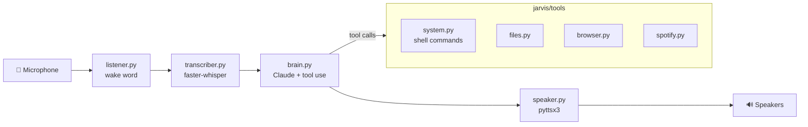

<div align="center">

# 🎙️ J.A.R.V.I.S.

**A voice assistant for your Windows PC, inspired by Iron Man's J.A.R.V.I.S.**

Say *"Jarvis"* and ask it anything. It answers out loud and can control your PC, your browser and Spotify for you.


</div>

---

## ✨ Features

| | |
|---|---|
| 👂 **Wake word** | Always listening for "Jarvis" (you can change it). It keeps listening for a few seconds after replying, so follow-up questions don't need the wake word. |
| 🔒 **Private transcription** | Speech-to-text runs **locally** with faster-whisper. Your voice is never uploaded to be transcribed. |
| 🧠 **Claude as the brain** | Answers general questions directly and decides when it needs a tool to *do* something. |
| 🖥️ **Controls your PC** | Runs Windows commands, opens apps and manages files. |
| 🌐 **Browser** | Opens sites and runs web searches. |
| 🎵 **Spotify** | Search, play, pause, skip, change volume. |
| 🗣️ **Talks back** | Offline text-to-speech, with a choice of voice and speed. |
| 🛡️ **Safety guardrail** | Before running a risky command, it reads the command aloud and waits for you to say "yes". |

## 🏗️ How it works



```
jarvis/
├── jarvis/
│   ├── main.py          # entry point, main loop
│   ├── config.py        # loads settings from .env
│   ├── listener.py      # microphone + wake word
│   ├── transcriber.py   # local speech-to-text
│   ├── brain.py         # Claude conversation + tool dispatch
│   ├── speaker.py       # text-to-speech
│   └── tools/           # system, files, browser, spotify
├── requirements.txt
└── .env.example         # copy to .env and add your keys
```

## 🚀 Quick start

**You need:** Windows 10/11, Python 3.10+, a microphone and, for music control, the Spotify desktop app.

```powershell
git clone https://github.com/vpapirian/jarvis.git
cd jarvis
python -m venv venv
venv\Scripts\activate
pip install -r requirements.txt
copy .env.example .env      # then fill in your keys
python -m jarvis.main
```

> 💡 If `PyAudio` fails to install, run `pip install pipwin` and then `pipwin install pyaudio`.

The first run downloads the Whisper model, a one-time download of about 150–500 MB.

### 🔑 API keys

1. **Claude:** create a key at [console.anthropic.com](https://console.anthropic.com/) and set `ANTHROPIC_API_KEY`.
2. **Spotify (optional):** create an app at [developer.spotify.com/dashboard](https://developer.spotify.com/dashboard) with the redirect URI `http://127.0.0.1:8888/callback`, then set `SPOTIFY_CLIENT_ID` and `SPOTIFY_CLIENT_SECRET`. Playback control requires Spotify Premium.

## 💬 Try saying…

- *"Jarvis, what's the weather like in Seattle?"*
- *"Jarvis, open YouTube."*
- *"Jarvis, play Blinding Lights."*
- *"Jarvis, open Notepad and write down a grocery list."*

## ⚙️ Configuration

All settings live in `.env`. See `.env.example` for the full list.

| Setting | Default | What it does |
|---|---|---|
| `WAKE_WORD` | `jarvis` | The word that wakes it up |
| `WHISPER_MODEL_SIZE` | `small` | `tiny` / `base` / `small` / `medium` / `large-v3`. Larger models are more accurate but slower. |
| `WHISPER_DEVICE` | `cpu` | Set to `cuda` if you have an NVIDIA GPU |
| `CONFIRM_DANGEROUS_COMMANDS` | `true` | Asks out loud before running risky commands |
| `CONFIRM_ALL_COMMANDS` | `false` | Asks before **every** shell command |
| `FILES_ROOT` | *(blank)* | Restricts file access to a single folder |

## 🧩 Adding a tool

1. Write a plain Python function in `jarvis/tools/`. `browser.py` is the simplest example to copy.
2. Add its schema to the `TOOLS` list in `jarvis/brain.py`.
3. Add a matching branch in `Brain._dispatch()`.

Claude starts using the new tool automatically whenever it's relevant.

## 🧪 Tests

The unit tests need no microphone, network or API key:

```bash
pip install anthropic python-dotenv pytest
python -m pytest
```

## 🩺 Troubleshooting

- **"No default input device":** set a default microphone in Windows Sound settings, or set `INPUT_DEVICE_INDEX` in `.env`.
- **Transcription is slow:** set `WHISPER_MODEL_SIZE=base`, or use `cuda` if you have an NVIDIA GPU.
- **"No active Spotify device":** open the Spotify app and press play once.
- **It mishears the wake word:** try a more distinctive phrase, such as "hey jarvis".

---

<div align="center">Built by <a href="https://github.com/vpapirian">Vatche Papirian</a></div>
